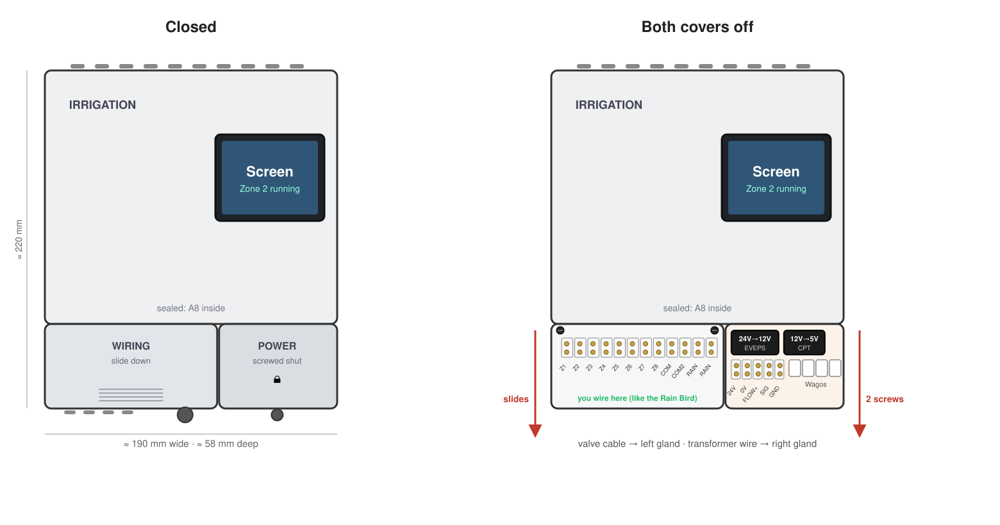
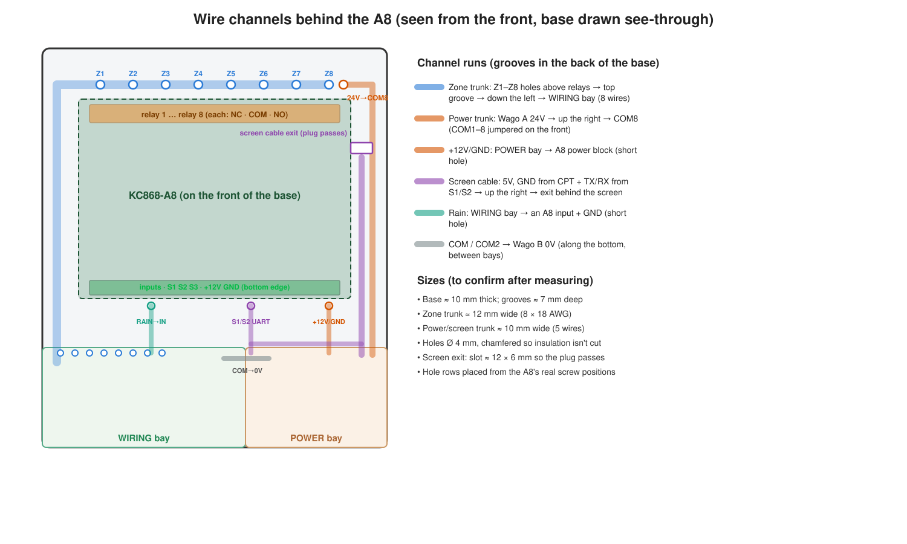

# Irrigation controller case (plan)

A printed, wall-mounted box for the KC868-A8 that works like the Rain Bird it replaces: the
electronics are sealed at the top, and the bottom holds the terminals you wire. Runs from **one
plug**. Agreed 2026-10-31; sizes are estimates until the parts are measured. See
[irrigation.md](irrigation.md) for the controller itself.



## Layout (about 190 × 220 × 66 mm)

| Part of the box | Holds | Opened |
|---|---|---|
| **Upper, sealed** | KC868-A8 on its base plate; the Hosyond screen on the lid, over the A8's **right half** (the A8's ESP32 antenna at the left end stays under plain plastic) | rarely: lid hooks over a lip at the top, held by 2 screws reached from the wiring bay |
| **Lower left, WIRING** | Terminals Z1-Z8, COM, COM 2, RAIN, RAIN | often: cover **slides down** in side grooves; a small bump holds it shut |
| **Lower right, POWER** | EVEPS (24 V AC → 12 V), CPT (12 → 5 V), 4 Wagos, terminals 24V, 0V, FLOW+, SIG, GND | rarely: cover **held by 2 screws** underneath |

- No screws on the front. Labels ("IRRIGATION", terminal names) printed in dark grey with the
  Kobra X's multi-colour.
- Jumpers from the terminals up to the A8 are wired once and **run behind the A8**: the A8 sits
  on a printed **base** whose back face has the wire channels; the box's back wall closes them.
  A row of **holes through the base** sits just above the relay screws (one per wire), and another
  row at the bottom opens into the bays, so a jumper goes from its relay screw straight through its
  hole, down its channel, and out next to its terminal. Nothing shows in front, beside or behind
  the board. Adds about 8 mm of depth. All 8 zones, COM and power are pre-wired now, so the
  channels never need opening. Ends marked Z1… with heat-shrink or tape.
- The **screen cable** (4 wires: 5 V and GND from the CPT, plus TX/RX to two of the A8's sensor terminals)
  gets its own channel in the base too, from the POWER bay up the right edge to just behind the
  screen, then a short slack loop to a plug, so the lid lifts off after unplugging one connector.
- The screen talks to the A8 **directly over that wire (UART)**, not through Home Assistant or
  Wi-Fi: it shows the A8's status and sends its commands (run zone, stop, rain delay), and keeps
  working with Wi-Fi or HA down. HA still sees the A8 as before. Pins: see Wire channels.

## Power: one plug

```
outlet → Centropower PSU-40 (24 V AC 40 VA, auto-reset PTC; plugs in, 120 V stays in it)
          24V / 0V screws → 18/2 thermostat wire → POWER bay, right gland
            Wago A (24V): transformer 24V + relay COM1 (jumpered COM1-COM5) + EVEPS red
            Wago B (0V):  transformer 0V + COM / COM 2 terminals + EVEPS red
            Wago C (+12V): EVEPS yellow + A8 +12V + CPT red
            Wago D (GND):  EVEPS black + A8 GND + CPT black
            CPT yellow/black → screen 5 V / GND (and FLOW+ / GND for a flow sensor later)
```

- **EVEPS:** yellow is **+**, black is **−**. Check both converters with the meter on DC before
  connecting (12 V and 5 V) and the transformer's no-load voltage on AC (EVEPS takes up to 28 V).
- No fuse: the transformer's PTC protects it. No fan, no temperature probe (about 6 W in total).
- Load: under 1 A of the transformer's 1.6 A; the A8 + screen draw under 1 A of the EVEPS's 3 A.

## Terminals

| WIRING (left) | | POWER (right) | |
|---|---|---|---|
| Z1-Z8 | zone wires → relay NO1-NO8 | 24V, 0V | transformer |
| COM | white valve common → 0V | FLOW+, SIG, GND | flow sensor, later (5 V supply) |
| COM 2 | second common, spare | | |
| RAIN, RAIN | rain sensor, later → an input + GND | | |

Relay screws read **NC - COM - NO** left to right with the orange block at the top, and **relay 1
is at the left end** (Ethernet port side); zone jumpers go on **NO**.

Both sides use the GUBCUB screw strips, cut to length (12 positions on the WIRING side, 5 on the
POWER side), screwed down through their own mounting holes. On each strip a small printed
**clip** covers the upper row (the jumpers to the A8), so only the screws you wire are exposed.

## Wire channels (behind the A8)



| Run | From → to | Route |
|---|---|---|
| Zone trunk (8 wires) | relay NO1-NO8 (relay 1 at the left end) → WIRING Z1-Z8 | hole above each relay → groove along the top → down the left edge → holes into the WIRING bay |
| 24 V feed (1) | Wago A → relay COM8 (right end, nearest the POWER bay) | up the right edge; COM1-COM8 jumpered on the front |
| 12 V (2) | Wago C / D → A8 +12V / GND | short hole straight down from the A8's power block |
| Screen cable (4) | CPT 5 V + GND, A8 sensor terminals GPIO14/GPIO13 (TX/RX) → screen | along the bottom, up the right edge, out through a slot (about 12 × 6 mm, the plug passes) behind the screen |
| Rain (2) | WIRING RAIN → an A8 input + GND | short holes at the bottom edge |
| Common (1) | COM / COM 2 → Wago B (0V) | along the bottom between the bays |

- Base about 10 mm thick, grooves about 7 mm deep; zone trunk about 12 mm wide, the right trunk
  about 10 mm. Holes 4 mm, chamfered so insulation isn't cut. Hole rows are placed from the A8's
  measured screw positions.
- **Screen link pins (KC868-A8, per the ESPHome device page):** the 1-wire/sensor terminals are
  terminals **S1** (DS18B20, GPIO14) and **S2** (DHT, GPIO13) for UART TX/RX to the screen, **S3**
  (GPIO32) for the flow sensor, **S4** (GPIO33) spare, all on the green 6-pin block GND / S1 / S2 /
  S3 / S4 / Vcc. Vcc measures **3.27 V** (the 3.3 V rail): fine for 3.3 V sensors, not for
  the screen. The flow sensor runs on 5 V from the POWER bay, so its signal needs a divider
  (5 V → 3.3 V) before S3. Not the board's S1/S2 *buttons* (reset and
  function key), which share the names. Confirm the terminal labels before wiring. Avoid the 433 MHz pins
  (GPIO2, GPIO15: boot strapping pins) and the I2C port P19 (SDA/SCL/GND/3V3: it carries the relay
  and input chips).

## Air and cables

- Vents: intake slots under the box, exhaust slots on top, louvres angled down so drips and dust
  can't fall in. Screen backlight off after 1 minute idle.
- Cables enter **from below** through PG glands: valve cable on the left (PG11, or PG13.5 if the
  cable is over 10 mm), transformer wire on the right (PG7), plus spare **knockouts** (thin
  printed discs to pop out) on the bottom, back and outer sides. None on top.
- Transformer: printed **terminal clip** covers its two screws and holds the cable; the cable runs
  up the wall in paintable raceway. Wire: solid 18 AWG, hooked clockwise under the screws.

## Printed parts (PETG, white or light grey, no supports)

| # | Part |
|---|---|
| P1 | box (upper + both lower bays, one piece) |
| P2 | lid with the screen window |
| P3 | WIRING slide-down cover |
| P4 | POWER cover (2 screws) |
| P5 | transformer terminal clip |
| P6 | A8 base: wire channels on its back, pass-through holes at the relay row and the bays |
| P7 | terminal strip clips (cover the strips' upper row) |
| — | test strip: insert holes 3.9 / 4.0 / 4.1 / 4.2 mm, to pick the fit |

0.4 mm nozzle, 0.2 mm layers, 4 walls, 25% gyroid. Threads: M3 brass heat-set inserts
(M3 × 4 × 5 for lids and covers, M3 × 6 × 5 for posts), soldering iron at about 240 °C; nut
pockets are a fallback. Wall: #8 screws and anchors through keyholes in the back.

## Parts

All ordered or in hand (2026-10-31): Centropower PSU-40, EVEPS EV36-A121203, CPT C1205003,
GUBCUB terminal strips, M3 screw kit, M3 heat-set inserts, Hosyond ESP32-S3 3.5" screen, PG
gland pack, wall screws and anchors, PETG, soldering iron, Wagos, 18/2 thermostat wire,
heat-shrink.

## Measured (KC868-A8, 2026-11-02, calipers; orange relay block at the top)

| What | Inches | mm |
|---|---|---|
| Board, left-right | 5 | 127.0 |
| Board, top-bottom | 4.35 | 110.5 |
| Overall left-right, with what sticks out | 6 | 152.4 |
| H1-H4: half holes (open at the edge), one per corner, centre from the edge | 0.1 | 2.5 |
| H5 (full hole, on the corner flap): from left / from top | 0.1 / 0.54 | 2.5 / 13.7 |
| H6 (full hole): from left / from top | 2.715 / 0.7 | 69.0 / 17.8 |
| H7 (full hole): from right / from top (= 3.5" / 88.9 mm from left) | 1.5 / 1.8 | 38.1 / 45.7 |
| 2.25" on the sketch: straight part of the right edge between the corner notches (to confirm) | 2.25 | 57.2 |

**From the "Kincony KC868-A8 Rail Mount" model (Printables 6665458; STL files kept by the user,
not in the repo), which fits the board:**
- Base plate (Grundplatte.stl): 152.2 x 110.2 mm, 4.4 mm thick; the measured outline.
- The board's 4 screws: standoffs Ø8 mm, 2.4 mm tall on the 2 mm plate (that gap clears the
  solder leads under the board, checked by the user), each with a Ø2.0 mm hole (self-tapping M2 /
  M2.5 into plastic), at (from the plate's left, from its top) 13.6 / 7.5, 139.1 / 7.5, 42.4 / 61.8 and
  68.9 / 89.8 mm. These win over the hand measurements of H5-H7 above.
- Its enclosure (Gehause_1.stl) stands 46.4 mm out from the plate: everything on the board fits
  in about 42 mm above it. Enough for the planned 66 mm box.

Still useful to measure: how far the orange and green blocks stick out past the top and bottom
edges (for the wiring channels), and the relay screw row's distance from the edge.

## Needed before modelling

1. Base plate: length × width, hole positions and diameter.
2. KC868-A8: tallest part above the board.
3. Screen: outer size, thickness, visible area, hole positions; a photo of the back (for drivers).
4. Converters and the Centropower's bottom end (width × depth, screw spacing): measured on arrival.
5. Valve cable thickness (gland size).

## Steps

1. Measure (above). 2. Model in OpenSCAD (parametric) and send a preview. 3. Print the insert test
strip and a thin back-plate test fit. 4. Print P1-P5. 5. Assemble and wire, switch from the Rain
Bird to the Centropower, run each zone for a minute.
